# Cancer Risk Predictor

A full stack breast cancer risk prediction system. A Python service trains and serves a machine learning model on the Breast Cancer Wisconsin (Diagnostic) dataset, a Spring Boot API manages patients, users and stored assessments, and a React dashboard lets clinicians run assessments and see why the model made each prediction.

> **Medical disclaimer:** this project is for educational and research purposes only. It is **not** a medical device and must not be used to diagnose, treat or make decisions about real patients. The model is trained on a small public research dataset and its output is not a diagnosis.

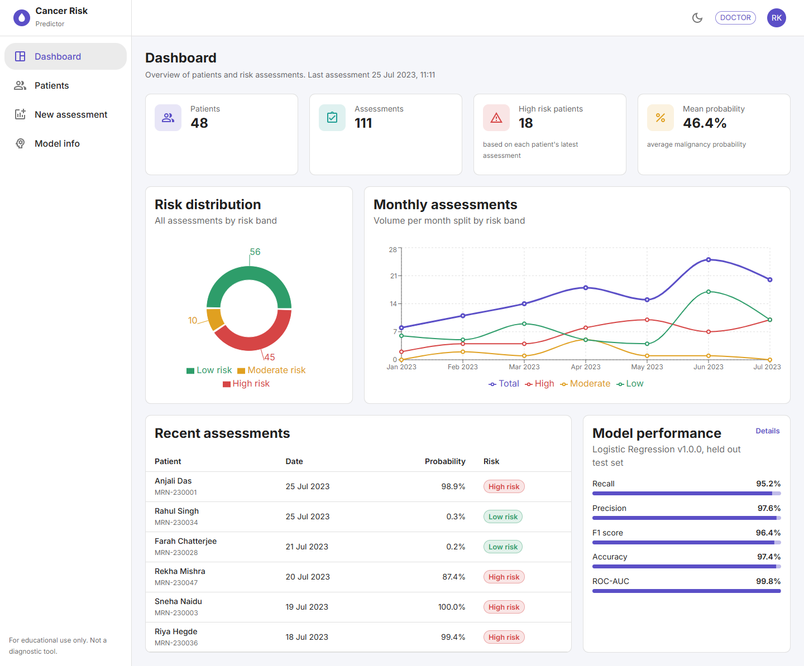

## Contents

- [Features](#features)
- [Architecture](#architecture)
- [Tech stack](#tech-stack)
- [Machine learning approach](#machine-learning-approach)
- [API overview](#api-overview)
- [Database schema](#database-schema)
- [Folder structure](#folder-structure)
- [Getting started](#getting-started)
- [Environment variables](#environment-variables)
- [Running the tests](#running-the-tests)
- [Screenshots](#screenshots)
- [Future improvements](#future-improvements)
- [License](#license)

## Features

**Machine learning service**
- Training pipeline with scaling, univariate feature selection, SMOTE oversampling and a stratified train/test split
- Logistic Regression, Random Forest, SVM and XGBoost compared with stratified 5 fold cross validation and grid search
- Best model chosen by recall, saved with joblib together with its preprocessing steps and a version string
- SHAP explanations for every prediction, returning the top contributing features
- Configurable Low / Moderate / High risk bands
- Flask API with pydantic validation, structured JSON errors and request logging

**Backend**
- Layered Spring Boot 3 application (controller, service, repository, entity, DTO, MapStruct mapper)
- Stateless JWT authentication with refresh tokens, BCrypt passwords and ADMIN, DOCTOR and ANALYST roles enforced at method level
- Patients CRUD with paging, sorting and search, assessment history per patient
- Assessments scored by the ML service through a client with timeouts, retries and a clean fallback error
- Dashboard statistics (risk distribution, monthly trend, model performance) and CSV export
- PostgreSQL schema managed by Flyway, with demo users, patients and assessments
- Swagger UI, Actuator health probes, audit log of every write

**Frontend**
- Login and registration with client side validation
- Role based routing and navigation
- Dashboard with summary cards, risk distribution pie chart, monthly trend chart and model performance card
- Searchable, sortable, paginated patient table with add and edit dialogs
- Grouped 30 field assessment form with sensible defaults, followed by a result page with probability gauge, risk badge and SHAP bar chart
- Patient history with probability and measurement trends
- Model comparison page with cross validation and test metrics
- Light and dark theme, responsive layout, loading and error states, toast notifications
- axios interceptor that attaches the access token and transparently refreshes it

## Architecture

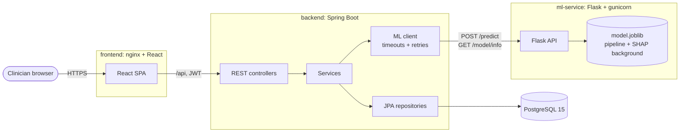

The browser only talks to nginx. nginx serves the React build and proxies `/api` to the backend, so no CORS setup is needed in production. The backend is the only component that talks to the ML service and to the database. A more detailed walk through is in [docs/architecture.md](docs/architecture.md).

## Tech stack

| Layer | Technology | Version |
| --- | --- | --- |
| ML service | Python | 3.10.11 |
| | scikit-learn | 1.2.2 |
| | XGBoost | 1.7.5 |
| | imbalanced-learn | 0.10.1 |
| | SHAP | 0.41.0 |
| | pandas / NumPy / SciPy | 1.5.3 / 1.24.3 / 1.10.1 |
| | Flask / flask-cors / gunicorn | 2.3.2 / 3.0.10 / 20.1.0 |
| | pydantic | 1.10.9 |
| | matplotlib / seaborn | 3.7.1 / 0.12.2 |
| | pytest | 7.3.1 |
| Backend | Java (Eclipse Temurin) | 17.0.7 |
| | Spring Boot | 3.0.6 |
| | Maven (wrapper) | 3.9.2 |
| | jjwt | 0.11.5 |
| | springdoc-openapi | 2.1.0 |
| | Lombok / MapStruct | 1.18.26 / 1.5.3.Final |
| | Testcontainers | 1.18.0 |
| Frontend | Node.js | 18.16.0 |
| | React | 18.2.0 |
| | TypeScript / Vite | 5.0.4 / 4.3.9 |
| | MUI material / icons | 5.13.3 / 5.11.16 |
| | React Router / axios / Recharts | 6.11.2 / 1.4.0 / 2.6.2 |
| | React Hook Form / zod | 7.43.9 / 3.21.4 |
| | Vitest / Testing Library | 0.31.4 / 14.0.0 |
| Infrastructure | PostgreSQL | 15.3 |
| | nginx | 1.24.0 |
| | Docker Compose file format | 3.8 |

## Machine learning approach

**Dataset.** The Breast Cancer Wisconsin (Diagnostic) dataset ships with scikit-learn, so no download is needed. It has 569 fine needle aspirate samples (212 malignant, 357 benign) with 30 numeric features: the mean, standard error and worst value of ten nucleus measurements such as radius, texture and concave points. The target is re-encoded so that **1 means malignant**, making malignant the positive class.

**Exploratory analysis.** `python -m app.eda` writes a class distribution chart, a correlation heatmap, distributions of the most predictive features and a summary table to `ml-service/reports/`. Many features are strongly correlated (radius, perimeter and area move together), which motivates feature selection.

**Preprocessing.** Every model is wrapped in the same imbalanced-learn pipeline:

1. `StandardScaler`
2. `SelectKBest(f_classif, k=20)` to drop redundant features
3. `SMOTE` to balance the classes. Because it sits inside the pipeline it only ever sees training folds and is skipped at prediction time.
4. The classifier

The data is split 80/20 with stratification (455 train, 114 test) and a fixed random seed.

**Model comparison.** Each candidate is tuned with `GridSearchCV` over stratified 5 fold cross validation, scoring recall, precision, F1, accuracy and ROC-AUC and refitting on recall. Results on the held out test set from the current training run:

| Model | CV recall | Test recall | Precision | F1 | Accuracy | ROC-AUC |
| --- | --- | --- | --- | --- | --- | --- |
| **Logistic Regression** (selected) | **0.9647** | **0.9524** | 0.9756 | 0.9639 | 0.9737 | 0.9983 |
| Support Vector Machine | 0.9588 | 0.9524 | 0.9524 | 0.9524 | 0.9649 | 0.9947 |
| Random Forest | 0.9529 | 0.9286 | 1.0000 | 0.9630 | 0.9737 | 0.9949 |
| XGBoost | 0.9529 | 0.9286 | 1.0000 | 0.9630 | 0.9737 | 0.9970 |

The selected model misses 2 of the 42 malignant cases in the test set and raises 1 false alarm out of 72 benign cases.

**Why recall.** In screening, a false negative (telling someone a malignant sample looks benign) is far more harmful than a false positive, which only leads to further tests. The best model is therefore picked by **cross validated recall**, with F1 and ROC-AUC as tie breakers. Selection uses cross validation scores rather than the test set, so the test numbers above stay an honest estimate.

**Explainability.** Every prediction comes with SHAP values for the features the model actually uses. The service picks the right explainer for the model family (`LinearExplainer` for logistic regression, `TreeExplainer` for Random Forest and XGBoost, `KernelExplainer` with a k-means background for SVM) and returns the top five features by absolute contribution, with their measured value and whether they push the prediction towards malignant or benign. Values are in log odds.

**Risk bands.** The malignancy probability is mapped to a band. The thresholds are set by environment variables:

| Band | Default rule |
| --- | --- |
| Low | probability < 0.30 |
| Moderate | 0.30 <= probability < 0.70 |
| High | probability >= 0.70 |

**Artifacts.** `python -m app.train` saves `artifacts/model.joblib` (fitted pipeline, feature list, selected features, SHAP background sample and model version) and `artifacts/metrics.json`, and writes evaluation plots to `reports/`. The Docker image trains the model at build time, so it always starts with a ready model.

> Compatibility note: SHAP 0.41.0 still references `np.bool`, which NumPy 1.24 removed. `app/explain.py` restores those aliases before importing SHAP so both pinned versions can be used together.

## API overview

### ML service (port 5000)

| Method | Path | Description |
| --- | --- | --- |
| GET | `/health` | `200 {"status":"ok"}` when the model is loaded, `503` otherwise |
| GET | `/model/info` | Model name and version, feature list and ranges, risk thresholds and full training metrics |
| POST | `/predict` | `{"features": {...30 values...}, "reference": "optional id"}` returns probability, prediction, risk band and top SHAP features |
| POST | `/predict/batch` | `{"records": [{"features": {...}}, ...]}`, up to 500 records |

Validation errors return `422` with `{"error": {"code": "validation_error", "message": ..., "details": [{"field", "message"}]}}`.

### Backend (port 8080)

Interactive documentation is available at `http://localhost:8080/swagger-ui.html`.

| Method | Path | Roles | Description |
| --- | --- | --- | --- |
| POST | `/api/auth/register` | public | Create a DOCTOR or ANALYST account |
| POST | `/api/auth/login` | public | Returns access and refresh tokens |
| POST | `/api/auth/refresh` | public | New token pair from a refresh token |
| GET | `/api/auth/me` | any | Current user |
| GET | `/api/patients?search=&page=&size=&sort=` | any | Paged, sortable patient search |
| GET | `/api/patients/{id}` | any | Patient details |
| POST / PUT | `/api/patients`, `/api/patients/{id}` | ADMIN, DOCTOR | Create or update a patient |
| DELETE | `/api/patients/{id}` | ADMIN | Delete a patient and their assessments |
| GET | `/api/patients/{id}/assessments` | any | Assessment history |
| POST | `/api/assessments` | ADMIN, DOCTOR | Score features with the ML service and store the result |
| GET | `/api/assessments?riskBand=` | any | Paged assessment list |
| GET | `/api/assessments/{id}` | any | Single assessment with features and explanation |
| GET | `/api/assessments/export?from=&to=&patientId=` | any | CSV download |
| GET | `/api/stats/summary`, `/monthly`, `/model` | any | Dashboard statistics |
| GET | `/api/admin/users`, `/api/admin/audit-log` | ADMIN | Users and audit trail |
| GET | `/actuator/health` | public | Liveness and readiness |

Errors share one body: `{"timestamp", "status", "error", "message", "path", "details": [{"field", "message"}]}`. More detail and examples are in [docs/api.md](docs/api.md).

## Database schema

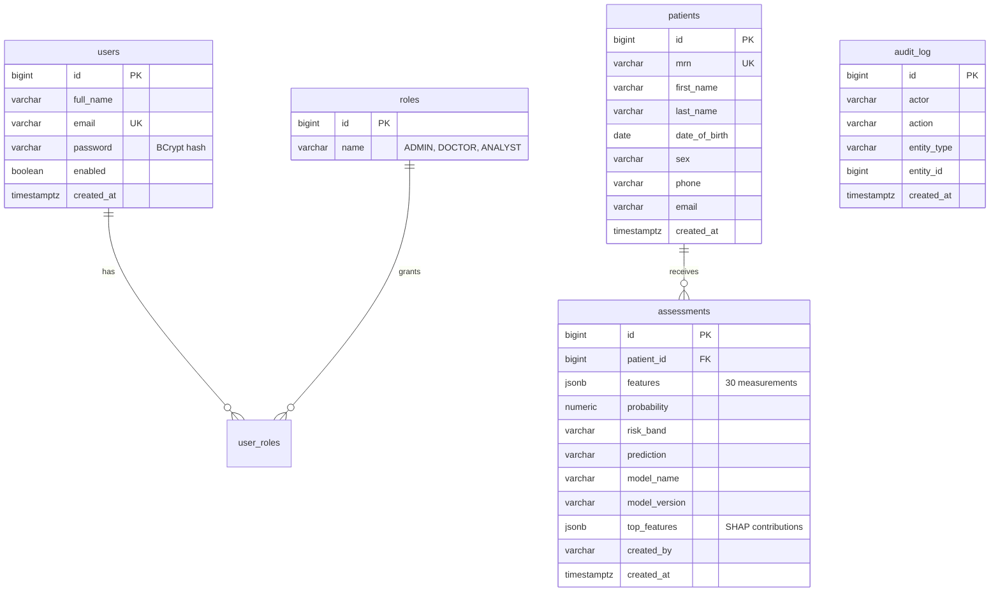

Migrations live in `backend/src/main/resources/db/migration`. `V1` creates the schema and roles. `V2` loads demo data: four users, 48 patients and 111 assessments dated January to July 2023. The demo assessments were produced by running real dataset rows through the trained model, so each stored probability and explanation matches what the API returns for those features (see `ml-service/scripts/generate_seed_sql.py`).

Demo accounts (password `Password@123`):

| Email | Role |
| --- | --- |
| admin@cancerrisk.dev | ADMIN |
| rohan.kapoor@cancerrisk.dev | DOCTOR |
| ananya.iyer@cancerrisk.dev | DOCTOR |
| kabir.shah@cancerrisk.dev | ANALYST |

Remove or replace `V2__seed_sample_data.sql` before using the schema for anything other than a demo.

## Folder structure

```
.
├── ml-service/
│   ├── app/                 config, data loading, EDA, preprocessing, training, SHAP, risk bands, Flask API
│   ├── scripts/             demo seed generator
│   ├── tests/               pytest suite
│   ├── reports/             EDA and evaluation plots, metrics.json
│   ├── Dockerfile           trains the model at build time, serves with gunicorn
│   └── requirements*.txt
├── backend/
│   ├── src/main/java/com/cancerrisk/
│   │   ├── client/          ML service client
│   │   ├── config/          security and OpenAPI config
│   │   ├── controller/      REST controllers
│   │   ├── domain/          JPA entities and enums
│   │   ├── dto/             request and response records
│   │   ├── exception/       error types and global handler
│   │   ├── mapper/          MapStruct mappers
│   │   ├── repository/      Spring Data repositories
│   │   ├── security/        JWT service, filter, user details
│   │   └── service/         business logic, CSV export
│   ├── src/main/resources/  application.yml, Flyway migrations
│   ├── src/test/            unit and integration tests
│   └── Dockerfile           multi stage build
├── frontend/
│   ├── src/
│   │   ├── api/             axios client, endpoints, types
│   │   ├── auth/            auth context, protected routes, token storage
│   │   ├── components/      layout, charts, gauge, dialogs
│   │   ├── pages/           routed pages
│   │   ├── theme/           light and dark theme
│   │   └── utils/           feature catalogue, formatting, validation schema
│   ├── nginx.conf
│   └── Dockerfile           Vite build served by nginx
├── docs/                    architecture and API notes, screenshots
├── docker-compose.yml
└── .env.example
```

## Getting started

### With Docker

Requirements: Docker with Compose v2.

```bash
cp .env.example .env        # then set POSTGRES_PASSWORD and JWT_SECRET
docker compose up --build
```

| Service | URL |
| --- | --- |
| Dashboard | http://localhost:3000 |
| Backend API and Swagger UI | http://localhost:8080/swagger-ui.html |
| ML service | http://localhost:5000/health |

Compose starts PostgreSQL first, waits for it and the ML service to report healthy, then starts the backend, and finally the frontend. The first build takes a few minutes because the ML image trains the models.

### Locally without Docker

You need Python 3.10, Java 17, Node 18.16 and a PostgreSQL 15 database.

**ML service**

```bash
cd ml-service
python3.10 -m venv .venv
source .venv/bin/activate          # Windows: .venv\Scripts\activate
pip install -r requirements-dev.txt
python -m app.eda                  # optional, writes plots to reports/
python -m app.train                # trains, compares and saves the best model
python wsgi.py                     # http://localhost:5000 (gunicorn -c gunicorn.conf.py wsgi:app on Linux)
```

**Backend**

```bash
createdb cancer_risk               # or create the database another way
cd backend
DB_URL=jdbc:postgresql://localhost:5432/cancer_risk DB_USERNAME=... DB_PASSWORD=... \
JWT_SECRET=$(openssl rand -base64 48) ./mvnw spring-boot:run
```

Flyway creates the schema and demo data on first start.

**Frontend**

```bash
cd frontend
npm ci
npm run dev                        # http://localhost:5173, proxies /api to localhost:8080
```

## Environment variables

| Variable | Used by | Default | Description |
| --- | --- | --- | --- |
| `POSTGRES_DB`, `POSTGRES_USER`, `POSTGRES_PASSWORD` | compose | `cancer_risk` / `cancer_risk` / required | Database settings |
| `DB_URL`, `DB_USERNAME`, `DB_PASSWORD` | backend | local `cancer_risk` database | JDBC connection |
| `JWT_SECRET` | backend | dev only value | HMAC key, at least 32 characters |
| `JWT_ACCESS_TTL`, `JWT_REFRESH_TTL` | backend | `15m`, `7d` | Token lifetimes |
| `ML_SERVICE_URL` | backend | `http://localhost:5000` | ML service base URL |
| `ML_CONNECT_TIMEOUT`, `ML_READ_TIMEOUT` | backend | `2s`, `15s` | HTTP timeouts |
| `ML_MAX_ATTEMPTS`, `ML_BACKOFF` | backend | `3`, `400ms` | Retry policy for network and 5xx errors |
| `CORS_ALLOWED_ORIGINS` | backend | `http://localhost:5173,http://localhost:3000` | Comma separated origins |
| `MODEL_VERSION` | ml-service | `1.0.0` | Version stored with the model |
| `RISK_LOW_MAX`, `RISK_HIGH_MIN` | ml-service | `0.30`, `0.70` | Risk band thresholds |
| `SHAP_TOP_FEATURES` | ml-service | `5` | Features returned per explanation |
| `MAX_BATCH_SIZE` | ml-service | `500` | Batch endpoint limit |
| `VITE_API_URL` | frontend | `/api` | API base URL baked into the build |

Secrets are only read from the environment. `.env` is ignored by git, and `.env.example` documents every value.

## Running the tests

```bash
# ML service: 35 tests for preprocessing, risk bands, training artifacts, SHAP for every model family and all endpoints
cd ml-service && pytest

# Backend: Mockito unit tests plus integration tests for repositories and controllers
cd backend && ./mvnw test

# Frontend: utilities, validation schemas, components, routing guard, login flow and token refresh
cd frontend && npm test
```

Backend integration tests need PostgreSQL. They start a `postgres:15.3` container through Testcontainers when Docker is available. Without Docker, point them at an existing empty database with `TEST_DATABASE_URL` (plus `TEST_DATABASE_USERNAME` and `TEST_DATABASE_PASSWORD`). If neither is available they are skipped and only the unit tests run. Every integration test runs in a transaction that is rolled back.

## Screenshots

**Sign in**

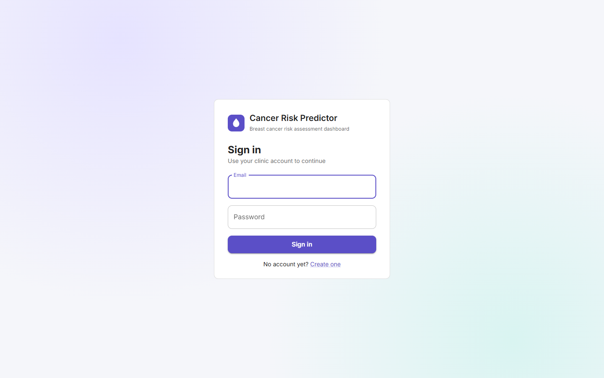

**Dashboard, light theme:** summary cards, risk distribution, monthly trend, recent assessments and model performance


**Dashboard, dark theme**

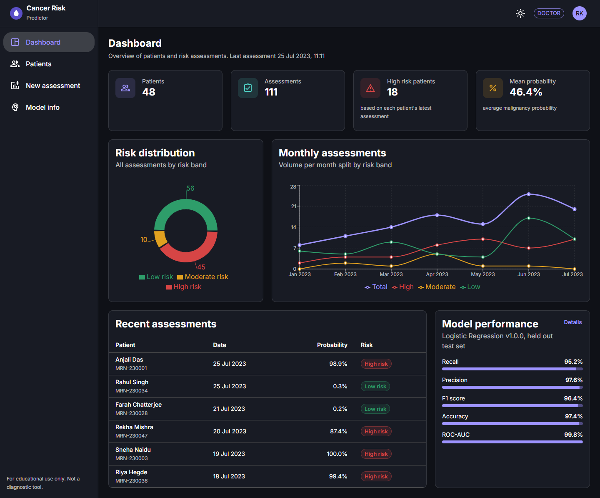

**Patients:** search, sorting, pagination and per patient actions

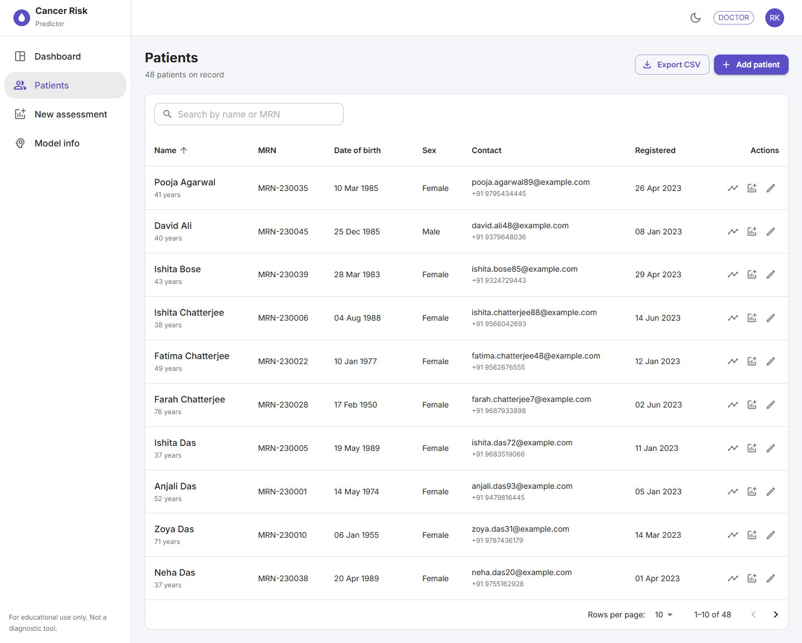

**New assessment:** 30 measurements grouped into mean, standard error and worst values, prefilled with dataset medians

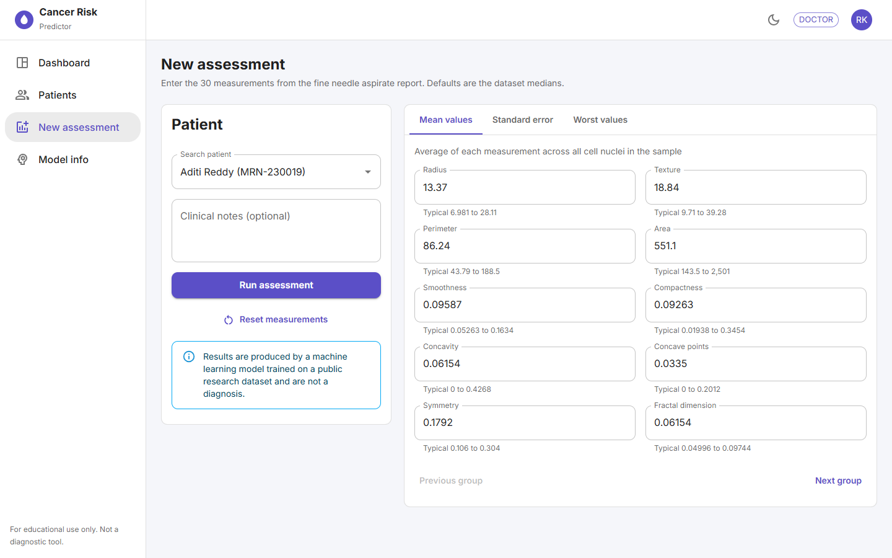

**Assessment result:** probability gauge, risk band and SHAP explanation

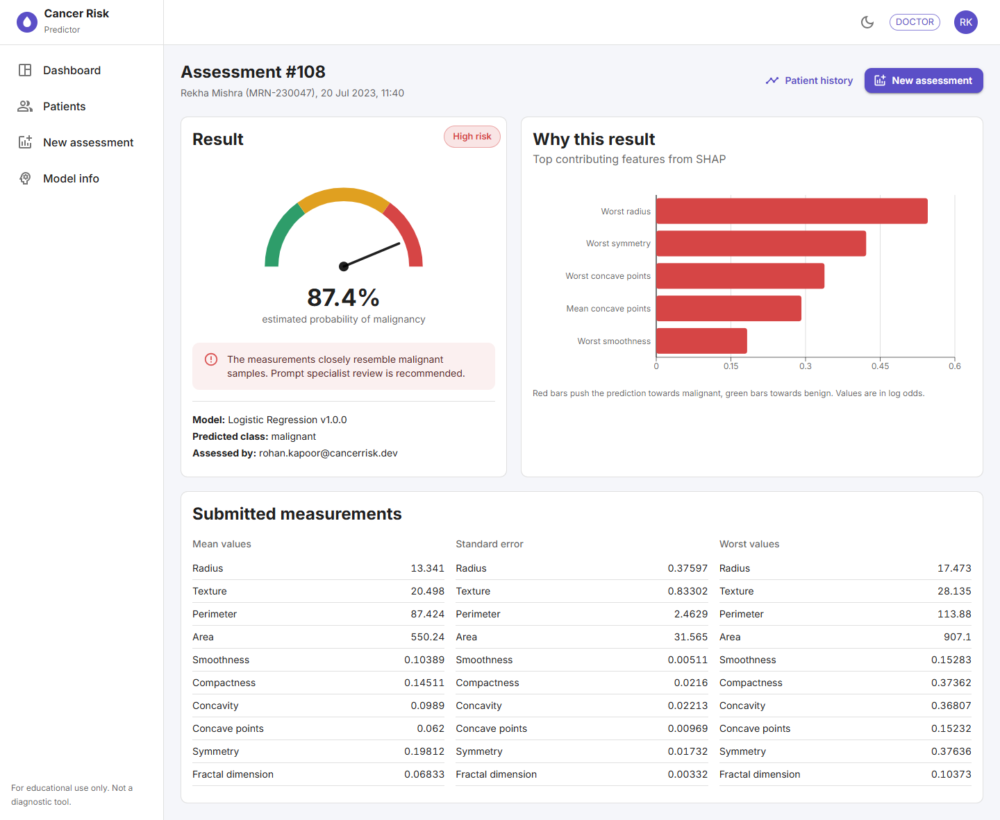

**Patient history:** probability and key measurements across visits

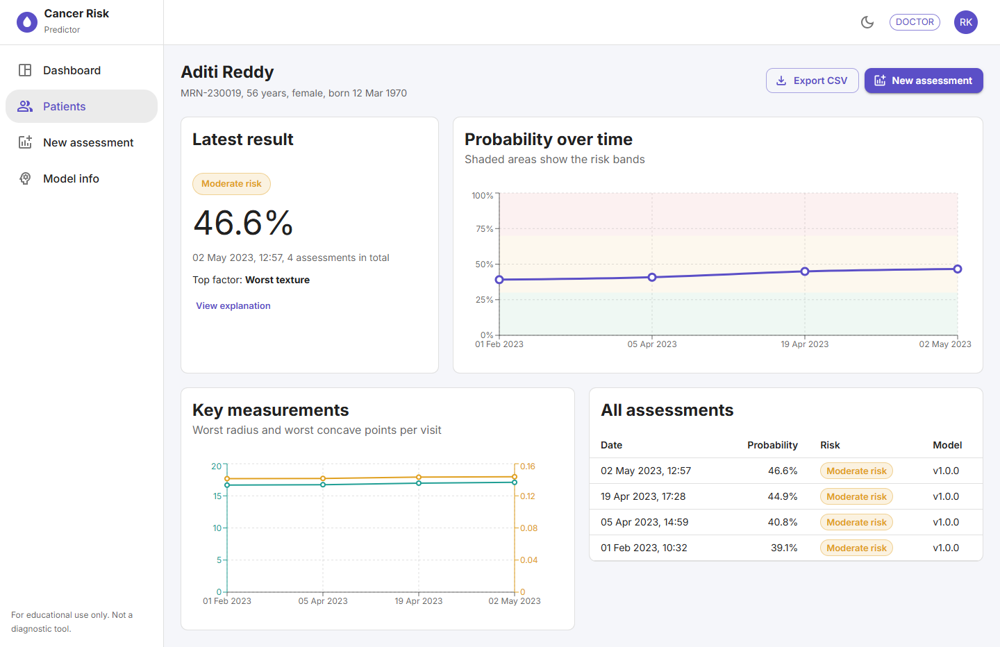

**Model information:** comparison of the four trained models, cross validation scores and confusion matrix

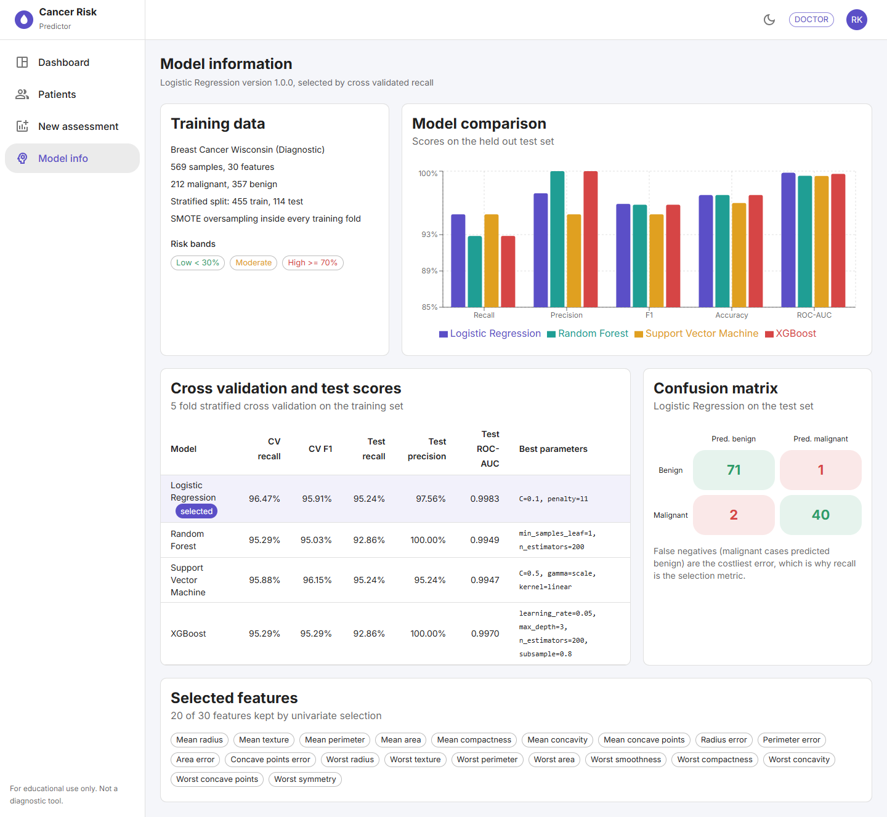

**Swagger UI**

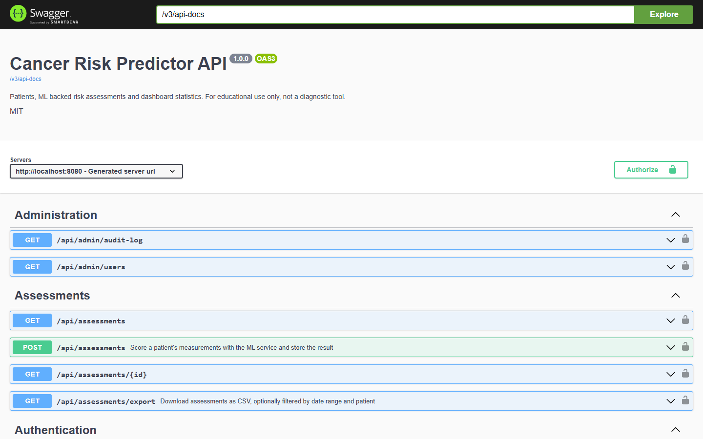

**Evaluation plots** generated by the training pipeline

| ROC curves | Confusion matrix | Model comparison |
| --- | --- | --- |
|  |  |  |

| Class distribution | Feature correlation | Top feature distributions |
| --- | --- | --- |
|  |  |  |

## Future improvements

- Calibrate probabilities (Platt or isotonic) and pick risk thresholds from a cost analysis instead of fixed values
- Report confidence intervals on the test metrics with bootstrapping, the test set has only 114 samples
- Model registry with side by side versions and the ability to roll back from the UI
- Batch upload of measurements from CSV using the existing `/predict/batch` endpoint
- Store refresh tokens server side so they can be revoked on logout
- Rate limiting on the authentication endpoints
- Field level encryption for patient contact details
- End to end tests that drive the full stack in a browser

## License

Released under the [MIT License](LICENSE).


