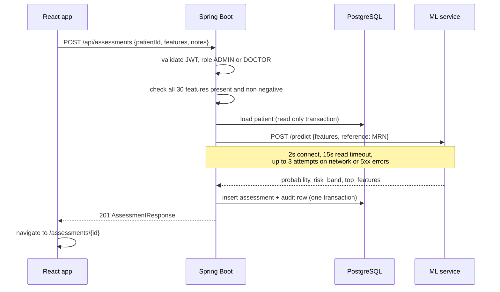

# Architecture notes

## Components

| Component | Responsibility | Talks to |
| --- | --- | --- |
| `frontend` | React single page app served by nginx. Renders the UI, holds the JWT pair in local storage and refreshes it on 401. | backend through nginx `/api` proxy |
| `backend` | System of record. Authentication and authorisation, patient registry, assessment storage, statistics, CSV export, audit log. | PostgreSQL, ml-service |
| `ml-service` | Stateless scoring. Loads one model bundle at start up and returns probabilities, risk bands and SHAP explanations. | nothing |
| `postgres` | Persistent storage. Schema owned by Flyway migrations in the backend. | |

The ML service has no database and no authentication. It is meant to sit on a private network where only the backend can reach it. In `docker-compose.yml` its port is published for convenience during development, remove that mapping in a real deployment.

## Creating an assessment



The call to the ML service happens outside a database transaction so a slow model never holds a pooled connection. If every attempt fails the backend answers `503` with a readable message and nothing is stored. A `4xx` from the ML service (invalid input) is not retried and becomes a `422`.

## Authentication

- `POST /api/auth/login` returns an access token (15 minutes) and a refresh token (7 days), both HS256 JWTs signed with `JWT_SECRET`. A `typ` claim distinguishes them, so a refresh token is rejected on normal endpoints and an access token is rejected by `/auth/refresh`.
- `JwtAuthenticationFilter` validates the access token on every request and loads the user, so a disabled or deleted account loses access immediately even with an unexpired token.
- Authorisation is declared with `@PreAuthorize` on controllers:
  - **ADMIN**: everything, including deleting patients and reading the audit log
  - **DOCTOR**: manage patients and create assessments
  - **ANALYST**: read only access to patients, assessments, statistics and exports
- Self registration can only create DOCTOR or ANALYST accounts.
- The frontend axios instance retries a request once after a 401 by calling `/auth/refresh`. Concurrent 401s share a single refresh call.

## Model bundle

`ml-service/artifacts/model.joblib` is a dict containing:

| Key | Content |
| --- | --- |
| `pipeline` | fitted imblearn pipeline: scaler, selector, SMOTE, classifier |
| `model_name`, `model_version`, `trained_at` | metadata |
| `feature_names` | the 30 input columns in training order |
| `selected_features` | the 20 columns kept by `SelectKBest` |
| `background` | 100 transformed training rows used by SHAP linear and kernel explainers |

On load the service checks that the feature list matches the code, so a bundle trained against a different schema fails fast instead of producing wrong predictions.

## Error format

Both services return JSON errors, never HTML pages.

ML service:

```json
{"error": {"code": "validation_error", "message": "request validation failed",
           "details": [{"field": "features.mean_radius", "message": "ensure this value is greater than or equal to 0"}]}}
```

Backend:

```json
{"timestamp": "2023-05-14T09:12:44Z", "status": 400, "error": "Bad Request",
 "message": "Invalid feature set", "path": "/api/assessments",
 "details": [{"field": "features.worst_area", "message": "is required"}]}
```

## Health checks and start up order

`docker compose` waits for `pg_isready`, then for the ML service `/health` (which only returns 200 once the model is loaded), then starts the backend. The backend readiness probe `/actuator/health/readiness` gates the frontend container.
